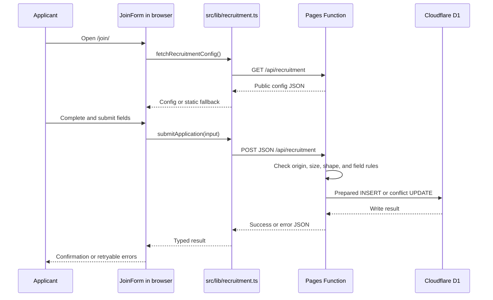

## The complete path

## What each layer does

1. `src/app/join/page.tsx` builds the public recruitment page and mounts
   `JoinForm`.
2. `JoinForm` keeps form inputs and feedback in React state. On mount it calls
   `fetchRecruitmentConfig()`.
3. `src/lib/recruitment.ts` requests `/api/recruitment` on the same origin when
   `NEXT_PUBLIC_API_URL` is unset. If config loading fails, it returns the
   static `DEFAULT_CONFIG`.
4. Cloudflare routes that URL to `functions/api/recruitment.ts`.
5. The Function checks the body and field values on the server. Browser-side
   checks are usability aids and do not replace these checks.
6. A prepared D1 statement inserts the row or updates the existing row with
   the same normalized email and recruitment cycle.
7. The client reports success only after an HTTP-success response whose JSON
   has `success: true`. On a failure, the form keeps the applicant's answers.

<Tip>
  When debugging, inspect DevTools → Network. Start with the request URL and
  HTTP status, then compare the JSON body with the matching branch in the
  Function and the result mapping in `src/lib/recruitment.ts`.
</Tip>

## The API's two public operations

| Method and path | Behavior |
|---|---|
| `GET /api/recruitment` | Returns the currently compiled recruitment configuration; it does not read application rows |
| `POST /api/recruitment` | Validates one application and writes it to D1; it does not return or list stored applications |

The GET response has `Cache-Control: no-store`. The POST returns `400` for
invalid JSON or fields, `403` for a mismatched browser Origin or closed
applications, `413` for a body larger than 24,000 bytes, `415` for a non-JSON
content type, and `503` for unavailable or failed storage. A honeypot request
returns a generic received result without writing to D1.

## Continue reading

- [Recruitment Function walkthrough](/04-code-tour/recruitment-function-line-by-line)
- [D1 row model and upsert behavior](/02-recruitment/database-model-and-upserts)
- [Failure and privacy behavior](/02-recruitment/privacy-and-failure-behavior)
